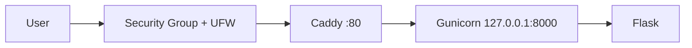

# WordRoom

Cloud Computing — PTI 2802
Pertemuan 3 — Project Inception

## Author
Nama: Reja
NIM: 25832073004
Kelas: PTI 2A

## Problem
Guru, dosen, dan komunitas belajar membutuhkan aktivitas interaktif yang bisa diikuti banyak orang sekaligus tanpa instal aplikasi. Sistem menyediakan kuis cepat berlomba berbasis browser, di mana pemain masuk ke ruangan lewat kode dan menjawab pertanyaan secara bersamaan, sehingga partisipasi meningkat dan hasilnya langsung terlihat.

## Target Users
- **Host** (guru, dosen, ketua komunitas): membuat ruangan dan membagikan kode.
- **Pemain** (siswa, mahasiswa, anggota komunitas): masuk lewat kode dari HP atau laptop.

## Features M03
- Baseline aplikasi Flask
- Health endpoint
- Deployment pada server cloud

Fitur kuis (ruangan, pertanyaan, skor) belum diimplementasikan dan dikembangkan pada pertemuan berikutnya.

## Status

| Pertemuan | Capaian | Status |
|---|---|---|
| M03 | Server pertama, aplikasi dasar, deployment HTTP | Selesai (tag `m03`) |
| M04 | Domain dan HTTPS | Dalam pengerjaan |
| M05 | Database untuk soal, ruangan, skor | Direncanakan |
| M06 | Container | Direncanakan |
| M09 | CI/CD | Direncanakan |

## Architecture



Detail ada di [`docs/architecture.md`](docs/architecture.md), [`docs/requirements.md`](docs/requirements.md), dan [`docs/adr/`](docs/adr/).

## Infrastructure
- AWS EC2 (ap-southeast-1), Ubuntu Server 24.04 LTS
- Sekitar 1 GB RAM, disk 20 GB
- Caddy (reverse proxy), Gunicorn (application server), systemd (service manager), UFW (firewall)

## Public Endpoint
`http://<PUBLIC_IP>/`

## Health Check
`GET /health` mengembalikan HTTP 200 dan JSON status.

| Path | Fungsi |
|---|---|
| `/` | Halaman utama |
| `/health` | Health check |
| `/api/info` | Metadata aplikasi |

## Menjalankan secara lokal

```bash
python3 -m venv .venv
source .venv/bin/activate
pip install -r requirements.txt
flask --app app run
```

Buka `http://127.0.0.1:5000/`.

## Deployment
Lihat [`docs/deployment.md`](docs/deployment.md).

## Security
- Login SSH hanya dengan key; `PermitRootLogin no` dan `PasswordAuthentication no`
- Firewall berlapis: Security Group dan UFW
- Backend hanya listen pada `127.0.0.1`
- Secret tidak disimpan di repository (`.env` diabaikan lewat `.gitignore`)
- Deploy key GitHub dicabut di akhir sesi praktikum

## Evidence
Bukti konfigurasi dan pengujian M03 ada di [`docs/evidence/m03/`](docs/evidence/m03/).

## Current Limitations
- Hanya HTTP, belum HTTPS
- Satu server tanpa redundansi
- Belum ada database
- Belum ada container
- Deployment masih manual

## Roadmap
DNS dan HTTPS (M04), data persisten (M05), container (M06), infrastructure as code (M07), CI/CD (M09), kemudian ruangan real-time dan uji beban.
