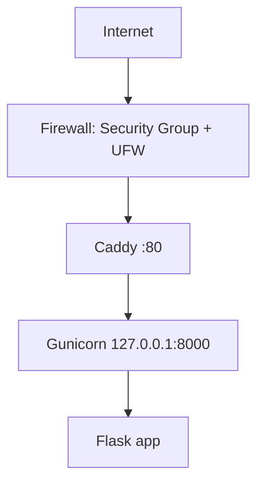
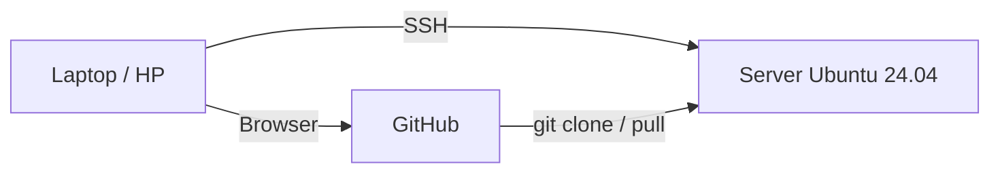

# Architecture v0.1 — WordRoom

## Deployment View

## Client, Repository, Server

## Komponen

| Komponen | Fungsi |
|---|---|
| Security Group (AWS) + UFW | Firewall berlapis: jaringan dan host |
| Caddy | Reverse proxy, titik masuk publik |
| Gunicorn | Application server (WSGI) |
| Flask | Aplikasi web |
| systemd | Menjalankan dan memulihkan service |
| GitHub | Sumber kebenaran kode |

## Resource Constraints
- 1 GB RAM
- Gunicorn: 1 worker, 2 thread

## Security Decisions
- Administrasi memakai user non-root
- SSH key authentication, password SSH dinonaktifkan
- Firewall aktif, hanya port yang diperlukan dibuka
- Backend tidak diekspos langsung ke internet

## Current Limitations
- HTTP saja (belum HTTPS)
- Satu server
- Belum ada database
- Belum ada container
- Belum ada CI/CD
- Deployment manual

## Planned Evolution
- M04: domain dan HTTPS
- M05: database untuk soal, ruangan, dan skor
- M06: container
- M07: infrastructure as code
- M09: CI/CD
- Lanjutan: ruangan real-time (WebSocket) dan uji beban
